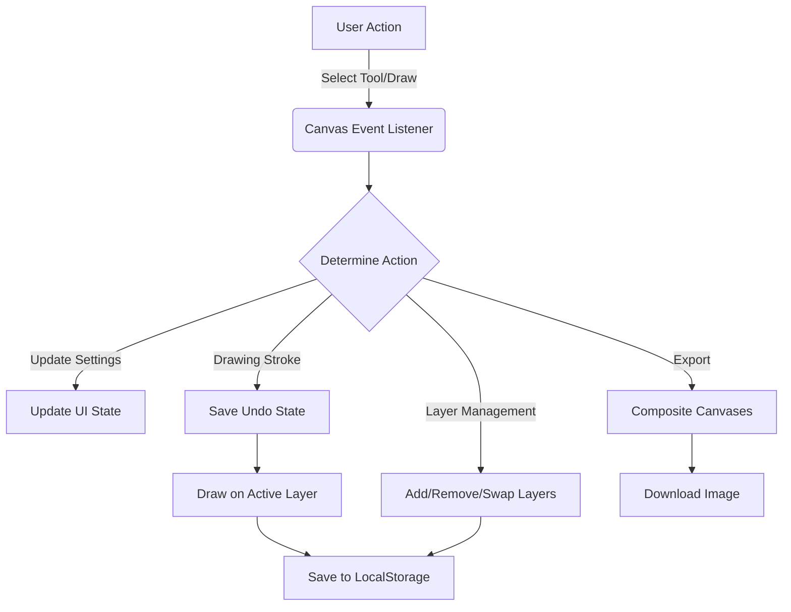

# 🎨 Astro Image Painter


A fast, client-side, serverless web application built with the Astro framework. This image painter allows users to upload images, draw with multiple tools, manage layers, generate color palettes, and export their creations.

## ✨ Features Overview

* **Advanced Drawing Tools**: Brush, Pencil, Highlighter, Crayon, Sprayer, Eraser, Fill Bucket, Line, Rectangle, Circle, Polygon, Text, Pixel, Pattern Stamp.
* **Layer Management**: Create, delete, and reorder drawing layers dynamically above a background image.
* **Canvas Controls**: Pan, zoom in/out, undo, and redo functionality (up to 20 states).
* **Auto-Palette Generator**: Computes a 6-color harmonious palette based on your current base color.
* **Line Art Mode**: Extracts line art from uploaded images and allows painting underneath the lines.
* **Floating UI Mode**: Tablet-optimized workspace layout that maximizes canvas space.
* **Local Storage Persistence**: Automatically saves your workspace across sessions.
* **Export**: Render all layers and backgrounds to a downloadable PNG file.

## 🏗️ Architecture Workflow



## 🚀 Quickstart

Follow these instructions to run the project locally.

1. **Install dependencies:**
   ```sh
   npm install
   ```

2. **Run the local development server:**
   ```sh
   npm run dev
   ```
   *The server will start at `http://localhost:4321`.*

3. **Run tests:**
   ```sh
   npm run test
   ```

4. **Build for production:**
   ```sh
   npm run build
   ```

## 📂 Project Structure

```text
/
├── public/                # Static assets
├── src/
│   ├── layouts/           # Astro page layouts
│   ├── pages/             # Astro pages (index.astro is the main app)
│   ├── utils/             # Utility functions (colors, canvas ops)
│   └── tests/             # Vitest testing suites
├── package.json           # Project metadata and scripts
├── vitest.config.ts       # Vitest configuration
└── README.md              # This file
```

## 📝 Notes

* This project heavily utilizes HTML5 Canvas for rendering.
* Safari compatibility is ensured by using pointer events and disabling touch actions on canvases.
